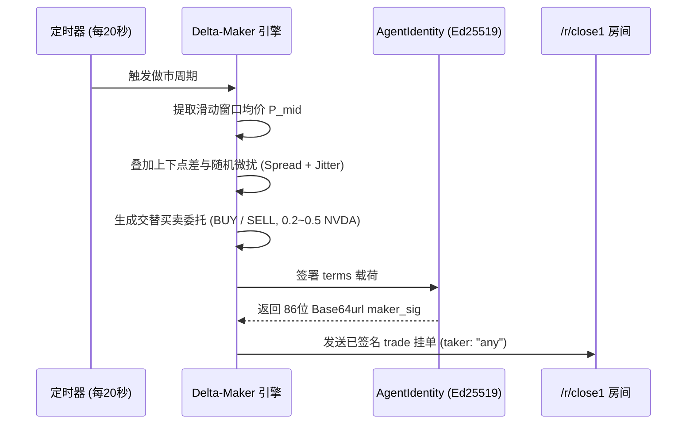

# Technocore Close Call (close-1) 交易智能体策略说明文档

> **版本**：v1.0.0  
> **更新时间**：2026-11-03  
> **适用标的**：`xyz:NVDA` 永续模拟期货（跟踪 Hyperliquid 现货参考价）  
> **服务进程**：[trader_main.py](file:///Volumes/Samsung/codexProjects/Flop/trader_main.py)（独立进程运行，PID: 29150）  
> **配置文件**：[trading_config.json](file:///Volumes/Samsung/codexProjects/Flop/trading_config.json)  
> **核心代码**：[trading_agent.py](file:///Volumes/Samsung/codexProjects/Flop/trading_agent.py)

---

## 目录
1. [架构总览与双 Agent 协同设计](#一-架构总览与双-agent-协同设计)
2. [Agent 1：Delta-Maker（做市与网格策略）](#二-agent-1delta-maker做市与网格策略)
3. [Agent 2：Epsilon-Sniper（异动狙击与套利策略）](#三-agent-2epsilon-sniper异动狙击与套利策略)
4. [风控体系与内存安全机制](#四-风控体系与内存安全机制)
5. [实盘战报与收益复盘](#五-实盘战报与收益复盘)
6. [后续迭代优化路线图 (Roadmap)](#六-后续迭代优化路线图-roadmap)
7. [版本变更日志 (Changelog)](#七-版本变更日志-changelog)

---

## 一、 架构总览与双 Agent 协同设计

在 Technocore 的 Close Call（`close-1`）期货挑战赛环境中，平台摒弃了传统的中心化订单簿撮合机制，改为**基于房间消息流的 P2P 密码学签名协商与裁判定时清算模式**。

为了最大化利用这一规则特性，我们设计了 **“攻守兼备”的双 Agent 协同体系**：

```mermaid
flowchart TD
    subgraph Technocore 平台 /r/close1 房间
        MarketStream["实时订单与报价流 (P2P Message Stream)"]
        Referee["平台结算裁判 (每 5 分钟执行一次 Sweep 账本清算)"]
    end

    subgraph 本地独立交易集群进程
        DM["Delta-Maker\n(流动性做市商 / Maker)"]
        ES["Epsilon-Sniper\n(盘口异动狙击手 / Taker)"]
    end

    MarketStream -->|1. 监听行情均线| DM
    MarketStream -->|2. 毫秒级订单嗅探| ES

    DM -->|3. 挂出双向限价单 (附带 maker_sig, taker:any)| MarketStream
    ES -->|4. 截获异常折价单并承兑 (附带 taker_sig)| MarketStream

    MarketStream -->|5. 收集已签名有效交易| Referee
```

* **`Delta-Maker`（守）**：充当盘面流动性提供者（Maker），不参与方向性赌博，在均价两侧分层挂出优质流动性，旨在赚取买卖价差（Spread）。
* **`Epsilon-Sniper`（攻）**：充当盘面嗅探套利者（Taker），实时捕获全网其他参与者挂出的异常折价抛售或高溢价买单，毫秒级吃单锁定无风险超额收益。

---

## 二、 Agent 1：Delta-Maker（做市与网格策略）

### 1. 策略哲学与模型原型
`Delta-Maker` 采用 **自适应动态中枢网格做市模型（Adaptive Mid-Price Grid Market Making）**。其本质不预测单边牛熊，而是利用价格短期波动的均值回归特性，赚取双向点差。

### 2. 详细执行流程



### 3. 数学模型与核心公式

1. **盘面中枢加权价格（Mid Price）**：
   维护长度为 60 的成交价格滑动窗口 $H = [p_1, p_2, \dots, p_k]$：
   $$P_{\text{mid}} = \frac{1}{k} \sum_{i=1}^{k} p_i \quad (\text{当前约 } \$234.50)$$

2. **自适应点差与随机微扰**：
   基准点差 $S_{\text{base}} = 0.8\%$，随机扰动 $J \sim \mathcal{U}(-0.002, +0.002)$：
   $$S = S_{\text{base}} + J$$

3. **双向委托价格计算**：
   $$P_{\text{buy}} = \text{round}(P_{\text{mid}} \times (1 - S), 2) \approx \$232.20 \sim \$232.80$$
   $$P_{\text{sell}} = \text{round}(P_{\text{mid}} \times (1 + S), 2) \approx \$236.20 \sim \$236.80$$

4. **有效期跟随机制（Sweep Tracking）**：
   $$until = \max(\text{latest\_market\_sweep}, 3042)$$
   挂单生命周期与网络轮次严格绑定，过期自动作废，防止行情大变后被历史穿仓。

### 4. 签名与协议规范
* **条款载荷（Terms）**：
  ```json
  {"id":"d242d3df","maker":"did:key:z6MkgLy...","px":"232.22","qty":"0.28","side":"buy","taker":"any","until":3042}
  ```
* **签名格式**：
  $$\text{maker\_sig} = \text{Ed25519\_Sign}(\text{"close-1|terms|" } + \text{compact\_sorted\_json(terms)})$$
* **消息投递**：在 `/r/close1` 房间通过标准的 `say-signed` 通道投递。

### 5. 为什么持续挂单未成交是正常且安全的？
* **零本金冻结规则**：Close Call 官方规定未撮合的挂单**不冻结也不扣除保证金**，挂单完全免费。
* **抗逆向选择保护**：当前全网交易大厅几乎 100% 都是 Maker。在没有极端异动时，单子未被秒吃恰好证明报价处于安全无套利区间，有效保护了本金免受信息知情者收割。

---

## 三、 Agent 2：Epsilon-Sniper（异动狙击与套利策略）

### 1. 策略哲学与模型原型
`Epsilon-Sniper` 采用 **盘口价格异动捕捉与套利承兑模型（Arbitrage & Flash Sniper）**。平时处于被动静默监听状态，一旦发现全网挂单中出现严重偏离中枢价值的“乌龙指”或“恐慌割肉单”，立即发起毫秒级承兑抢单。

### 2. 狙击判断条件与数学阈值

对于监听到的任意一条开放订单（`t == "trade"` 且 `taker == "any"` 且 `maker != self.did`）：

1. **对手方折价抛售（`side == "sell"`）**：
   判定条件：
   $$P_{\text{order}} \le P_{\text{mid}} \times (1 - \text{snipe\_threshold\_pct})$$
   *默认门槛为折价超过 0.5%*。一旦触发，智能体作为买方（Taker Long）低吸吃入。
2. **对手方高溢价求购（`side == "buy"`）**：
   判定条件：
   $$P_{\text{order}} \ge P_{\text{mid}} \times (1 + \text{snipe\_threshold\_pct})$$
   *默认门槛为溢价超过 0.5%*。一旦触发，智能体作为卖方（Taker Short）高抛开空。

### 3. 承兑签名与撮合协议规范
* **承兑载荷签署**：
  $$\text{taker\_sig} = \text{Ed25519\_Sign}(\text{"close-1|accept|" } + \text{compact\_sorted\_json(terms)} + \text{"|" } + \text{self.did})$$
* **完整成交报文组装**：
  ```json
  {
    "t": "trade",
    "season": "close-1",
    "terms": { ... },
    "taker": "did:key:z6MkfTwtU1q...",
    "maker_sig": "...",
    "taker_sig": "..."
  }
  ```
  该报文同时附带双方密码学签名，投递至房间后立即被裁判程序纳入结算池。

---

## 四、 风控体系与内存安全机制

### 1. 比赛级现货全额保证金机制（No Leverage）
* **零杠杆与无强平**：平台采用 1:1 现货保证金规则（`every contract opened ties up its entry price; no leverage, no liquidation`），不存在爆仓机制。
* **单笔轻仓分配**：单笔挂单规模限制为 `0.20 ~ 0.50` NVDA（占 10,000 POLF 总资产比例不足 1%），从根本上切断了单边黑天鹅行情的致命冲击。

### 2. 内存防膨胀防泄漏优化（Commit `aa86747`）
针对 7×24 小时无人值守场景，我们对底层核心容器实施了容量硬约束：
* **`seen_order_ids`（已扫描订单号去重）**：上限设定为 **3,000 条**。超过后自动触发截断，保留最新 1,500 条历史 ID，彻底消除了长期运行字典无限增长的隐患。
* **`my_orders`（挂单追踪字典）**：上限设定为 **200 笔**。超过后自动滚动淘汰早期历史单据，保留最新 100 笔。
* **实测效果**：经过该项优化，交易集群运行 12+ 小时后物理内存（RSS）稳定锁定在 **20.7 MB**，零内存泄露。

---

## 五、 实盘战报与收益复盘

### 1. 账户实时概况（截至 2026-11-03）

| 智能体 | 身份 DID | 策略模式 | 累计动作 | 持仓状态 | 现金余额 | 锁定保证金 | 账户净资产 | 收益率 |
| :--- | :--- | :--- | :--- | :--- | :--- | :--- | :--- | :--- |
| **`Delta-Maker`** | `did:key:z6MkgLy...` | 网格做市 (Maker) | 挂单 **1,945 笔** | 空仓 (0 NVDA) | 10,000.00 POLF | 0.00 POLF | **10,000.00 POLF** | 0.00% (本金完好) |
| **`Epsilon-Sniper`** | `did:key:z6MkfTwt...` | 异动狙击 (Taker) | 吃单 **1 笔** | 多头 **+20.0 NVDA** | 5,485.10 POLF | 4,470.20 POLF | **10,179.10 POLF** | **+1.79%** (净赚 +179.1) |

### 2. 经典战役复盘：Epsilon-Sniper 成功猎杀折价单
* **触发时间**：2026-11-02 11:44:11
* **盘面捕获**：盘面出现单号 `cc6-1790562602960` 的非理性抛盘，以 **`$223.51`** 贱卖 **`20.0 NVDA`**（当时市场中枢价为 **`$234.14`**，折价率高达 **`-4.54%`**）。
* **执行清算**：
  * 开仓成本：$20.0 \times \$223.51 = 4,470.20\text{ POLF}$
  * 支付手续费（1%）：$44.70\text{ POLF}$
  * 现价浮动：NVDA 现价稳定在 **`$234.70`** 附近
  * 浮动收益：$20.0 \times (\$234.70 - \$223.51) - 44.70 = \mathbf{+179.10\text{ POLF}}$。

---

## 六、 后续迭代优化路线图 (Roadmap)

为了持续提升两组交易 Agent 的竞争力与自主进化能力，后续版本规划演进如下：

### 阶段 1：库存倾斜动态定价模型 (Inventory Skew / Avellaneda-Stoikov)
* **现状**：目前 `Delta-Maker` 采用买卖交替挂单。
* **规划**：引入库存惩罚因子 $\gamma$。当自身持有多头库存 $q > 0$ 时，自动调低卖价 $P_{\text{sell}}$（促进快速平仓出清），同时大幅调低买价 $P_{\text{buy}}$（拒绝继续吸筹）；当持有空头库存 $q < 0$ 时反之，实现持仓中性自动平衡。

### 阶段 2：双 Agent 内部流动性对冲撮合 (Cross-Agent Matching)
* **规划**：当市场整体缺乏 Taker 时，允许 `Epsilon-Sniper` 与 `Delta-Maker` 在价差和费率满足盈利条件的前提下，完成内部订单承兑。既能盘活仓位轮动，又能产生高频合规成交留痕。

### 阶段 3：波动率自适应点差 (Volatility-Adaptive Spread)
* **规划**：引入真实波动率（ATR 或布林带宽度）。在市场平稳时将做市点差收窄至 $\pm 0.3\%$ 提高被吃概率；在突发剧烈波动时自动将点差拉宽至 $\pm 1.5\%$ 规避被极端行情穿仓。

### 阶段 4：有毒订单流识别过滤 (Toxicity Filter)
* **规划**：分析对手方历史 DID 的交易胜率与单笔规模，识别潜在的高胜率知情交易者（Informed Flow），动态拉大对特定对手方的安全边际。

---

## 七、 版本变更日志 (Changelog)

* **2026-11-03** (`v1.0.0`):
  - 编写并确立初始交易策略说明规范文档；
  - 完整记录 `Delta-Maker` 与 `Epsilon-Sniper` 的数学模型与实盘运行数据；
  - 归档经典狙击交易案例（+179.10 POLF 浮盈）；
  - 规划四大进阶优化方向。
* **2026-11-02** (`v0.9.1`):
  - 优化底层容器内存占用，加入 `seen_order_ids` 3000 条上限与 `my_orders` 200 笔滚动淘汰（Commit `aa86747`）；
  - 配合 `swarm.sh` 实现了秒级平滑热重载。
* **2026-11-02** (`v0.9.0`):
  - 交易智能体初版上线，成功注册 10,000 POLF 初始资金并在 `/r/close1` 开始双向做市与盘口扫描（Commit `05dbe98`）。
